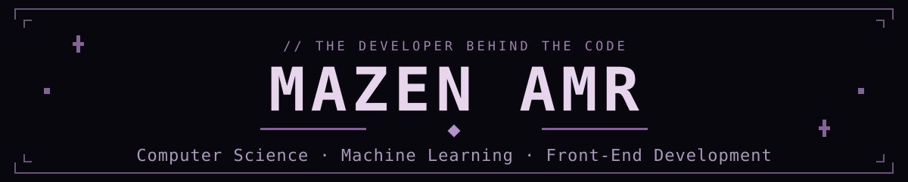

<!-- Personal GitHub README | mazenamr07 -->
<div align="center">
  
  

  <a href="https://www.linkedin.com/in/mazen-amr-567a5731b"></a>
  <a href="https://github.com/mazenamr07?tab=repositories"></a>
</div>

<br />

### ✦ A little about me

Hey, I'm **Mazen**, a Computer Science student at **Cairo University**. I enjoy understanding how things work behind the scenes, solving problems, and building software that puts those ideas into practice.

My interests span **C++, Python, algorithms, and web development**. I've also completed a **Front-End Development diploma at Route IT Training Center**, and my technical customer support experience has strengthened how I approach problems and communicate solutions.

- 🎓 **University:** Faculty of Computers and Artificial Intelligence, Cairo University
- 🧠 **Interests:** Data structures, algorithms, software design, and optimization
- 🛠️ **Focus:** Learning by building, testing, and improving real projects
- 📍 **Based in:** Egypt

---

### ✦ Languages & tools

<div align="center">
  
</div>

<p align="center"><sub>Coding fundamentals · Web applications · Databases · Version control</sub></p>

---

### ✦ Selected projects

| Project | What you'll find |
| :-- | :-- |
| 🧬 **[Genetic Algorithm Toolbox](https://github.com/mazenamr07/ga-toolbox-assignment-1)** | Modular C++ architecture for a genetic-algorithm toolbox, including configuration, population models, and operator interfaces. A collaborative academic project with ongoing integration. |
| 🗜️ **[Huffman File Compression](https://github.com/mazenamr07/Standard-Huffman-Assignment---Data-Compression)** | Python command-line program for lossless text-file compression and decompression using Huffman coding. |
| 🛡️ **[Digitopia](https://github.com/mazenamr07/Digitopia)** | React and Node.js web application for anonymous incident reporting, status tracking, and administrative workflows. |
| 🎮 **[Game Rental System](https://github.com/mazenamr07/Database-Assignment-GameRental)** | Java application for managing game inventory, accounts, rentals, and returns, using an H2 database. |

<sub>Project summaries reflect the repositories' published documentation. Some are team or academic projects.</sub>

---

### ✦ Current quests

```text
[01]  Sharpening my C++ and problem-solving skills
[02]  Exploring algorithms, optimization, and software architecture
[03]  Making projects clearer to build, understand, and maintain
```

<div align="center">
  <sub>Stay curious. Keep building. ✦</sub>
</div>
