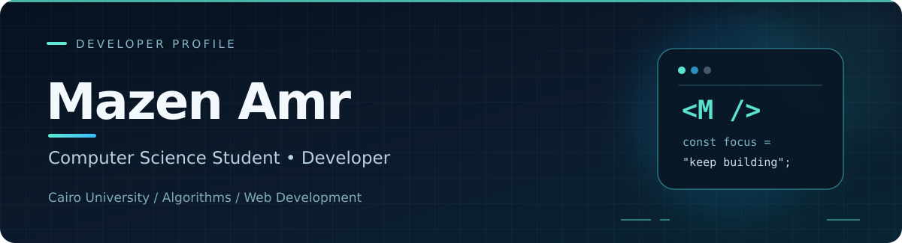

<!-- GitHub profile README · github.com/mazenamr07 -->
<div align="center">
  

  <a href="https://www.linkedin.com/in/mazen-amr-567a5731b"></a>
  <a href="https://github.com/mazenamr07?tab=repositories"></a>
</div>

## Hey, I'm Mazen 👋

I'm a **Computer Science student at Cairo University** who enjoys exploring how software works, solving algorithmic problems, and turning ideas into working projects.

My work spans **C++, Python, web applications, and university software engineering projects**. I also completed a **Front-End Development diploma at Route IT Training Center** and have experience in technical customer support.

- 🎓 Studying at the **Faculty of Computers and Artificial Intelligence, Cairo University**
- 🧠 Learning more about **algorithms, data structures, optimization, and software design**
- 🛠️ Building and documenting projects, from command-line tools to web apps
- 🌍 Based in **Egypt**

## Technologies I work with

<div align="center">
  
</div>

<p align="center"><sub>Programming · Web development · Databases · Developer tools</sub></p>

## Selected projects

| Project | What it explores |
| --- | --- |
| 🧬 **[Genetic Algorithm Toolbox](https://github.com/mazenamr07/ga-toolbox-assignment-1)** | A modular, team-based genetic-algorithm toolbox. My foundation work covers configuration, population models, operator interfaces, and the engine architecture; integration is ongoing. |
| 🗜️ **[Huffman File Compression](https://github.com/mazenamr07/Standard-Huffman-Assignment---Data-Compression)** | Python CLI for lossless text compression and decompression using Huffman coding. |
| 🛡️ **[Digitopia](https://github.com/mazenamr07/Digitopia)** | React and Node.js project for anonymous incident reporting, tracking report status, and administrative workflows. |
| 🎮 **[Game Rental System](https://github.com/mazenamr07/Database-Assignment-GameRental)** | Java application for managing a game catalog, rentals, returns, and user accounts with an H2 database. |

<sub>These links point to public repositories. Project descriptions are based on their published documentation; not every project is a solo project.</sub>

## What I'm working on

```text
01  Building stronger foundations in C++ and algorithmic problem-solving
02  Learning software architecture through team and academic projects
03  Making my projects easier to explore, build, and understand
```

## GitHub activity

<div align="center">
  
</div>

---

<div align="center"><sub>Curiosity → code → improvement.</sub></div>
